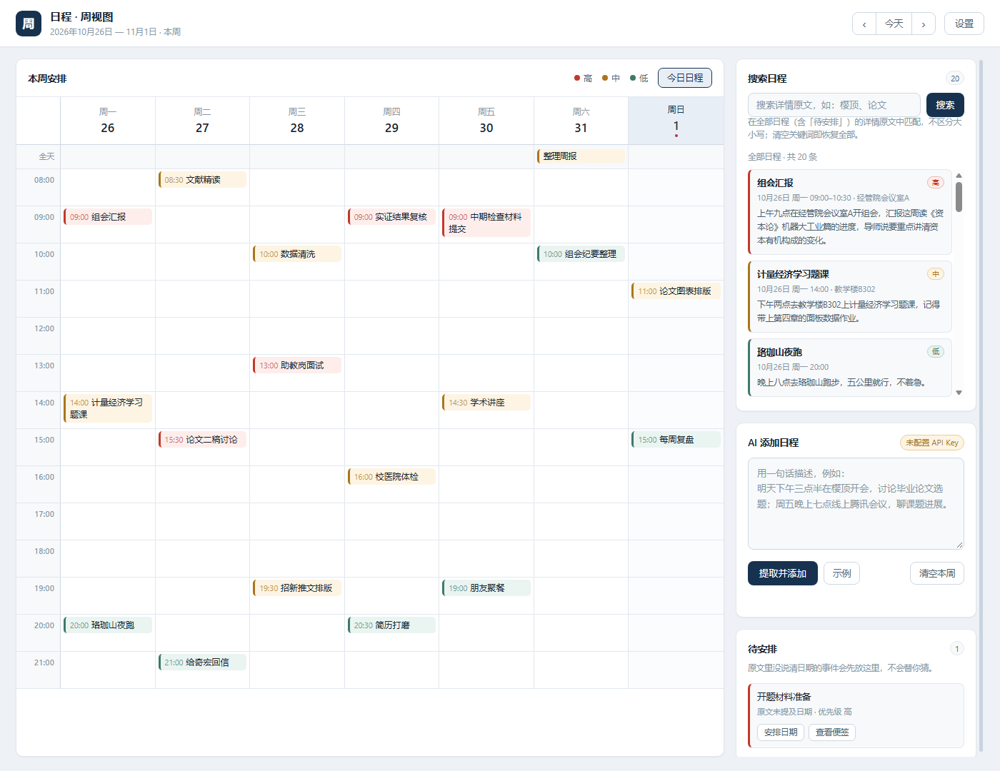
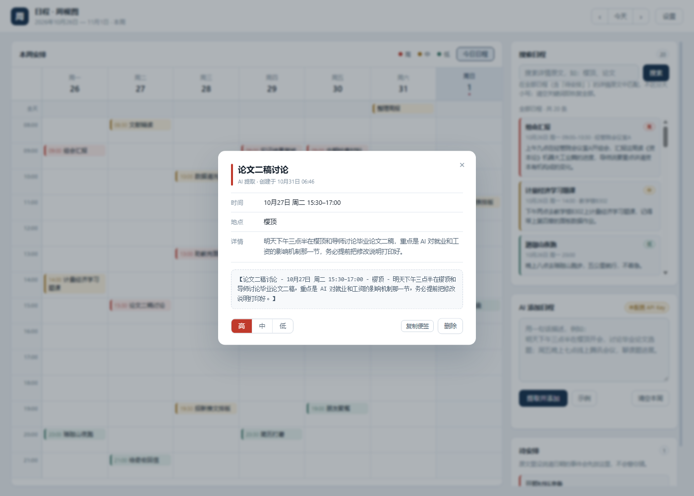

# 日程 · 周视图

一个接入了 DeepSeek API 的轻量日程管理工具：**说一句话 → 自动拆成结构化日程 → 排进周表格 → 手动标注优先级 → 随时搜索 / 一键看今天**。

零 npm 依赖，装好 Node 18+ 就能跑。

---

## 一、快速开始

```bash
# 方式一：命令行
node server.js

# 方式二：Windows 双击 start.bat（会自动打开浏览器）
```

启动后访问 **http://127.0.0.1:5173**。换端口：`PORT=5174 node server.js`。

不需要 `npm install`，`package.json` 里没有任何依赖。

---

## 二、安装说明

面向第一次把这个项目跑起来的开发者。全程**不需要 `npm install`**，唯一的硬性依赖是 Node.js。

### 环境要求

| 依赖 | 版本要求 | 说明 |
| --- | --- | --- |
| **Node.js** | **≥ 18.0**（本机实测 v22） | 服务端用到了全局 `fetch`，18 起才内置；16 会直接报 `fetch is not defined` |
| npm | 不强制 | 项目零依赖，`package.json` 里没有 `dependencies` 字段 |
| 浏览器 | Chrome / Edge / Firefox 近两年版本 | 需要 localStorage 与 CSS Grid / Flex |
| 操作系统 | Windows / macOS / Linux | 仅 Windows 提供 `start.bat` 双击启动 |
| DeepSeek API Key | 可选 | 不配也能运行，自动降级为本地规则解析 |

### 步骤总览

| 步骤 | 执行命令 | 依赖环境 | 预期结果 |
| --- | --- | --- | --- |
| 1 确认版本 | `node -v` | 系统终端可用 | 输出 `v18.x.x` 及以上 |
| 2 获取代码 | `git clone …` / Download ZIP | Git 2.x（可绕过） | 目录含 `server.js`、`public/` |
| 3 安装依赖 | `npm install`（可跳过） | npm，随 Node 附带 | 瞬间结束，无 `node_modules/` |
| 4 配密钥（可选） | `DEEPSEEK_API_KEY=… node server.js` | DeepSeek 账号 | 日志显示「已通过环境变量配置」 |
| 5 启动服务 | `node server.js` | Node ≥ 18 | 打印 `http://127.0.0.1:5173` |
| 6 打开浏览器 | 访问 `http://127.0.0.1:5173` | Chrome / Edge / Firefox | 出现周视图与右侧三块面板 |
| 7 跑测试 | `node test/core.test.js` | Node ≥ 18（`node:assert` 内置） | `21 通过 / 0 失败` |

### 第 1 步：确认 Node 版本

```bash
node -v
```

**预期结果**：输出 `v18.x.x` 及以上（如 `v22.20.0`）。
若提示 `command not found` 或版本低于 18，到 [nodejs.org](https://nodejs.org) 安装 LTS 版后重开终端。

### 第 2 步：获取代码

```bash
git clone https://github.com/shanxisheng108/week-schedule-deepseek.git
cd week-schedule-deepseek
```

没装 Git 时可改为：仓库首页 `Code → Download ZIP`，解压后进入目录。

**预期结果**：目录下能看到 `server.js`、`public/`、`package.json`、`start.bat`。

### 第 3 步：安装依赖（可跳过）

```bash
npm install
```

**预期结果**：命令瞬间结束，**不会生成 `node_modules/`**——本项目没有任何第三方依赖。这一步完全可以省略，不影响后续运行。

### 第 4 步：配置 DeepSeek API Key（可选）

不配也能用，只是抽取精度从「大模型」降为「正则规则」。两种配置方式：

```bash
# macOS / Linux
DEEPSEEK_API_KEY=sk-xxxxxxxx node server.js
```

```powershell
# Windows PowerShell
$env:DEEPSEEK_API_KEY = "sk-xxxxxxxx"; node server.js
```

也可以先启动、再在页面右上角「设置」里粘贴密钥（存在浏览器 localStorage）。完整说明见第四节。

**预期结果**：启动日志中 `API Key` 一行显示「已通过环境变量配置」；若走页面设置，则状态栏不再提示「未配置 API Key」。

### 第 5 步：启动服务

```bash
node server.js
# 或 npm start
# Windows 也可双击 start.bat（会自动打开浏览器）
```

**预期结果**：终端打印

```
  日程管理小工具 · 已启动
  本地地址   http://127.0.0.1:5173
  DeepSeek   https://api.deepseek.com
  API Key    未配置（可在页面右上角「设置」中填写）
```

端口被占用时换一个：`PORT=5174 node server.js`（PowerShell 下 `$env:PORT=5174; node server.js`）。

### 第 6 步：打开浏览器验证

访问 **http://127.0.0.1:5173**。

**预期结果**：出现周视图——周一至周日的空表格，右侧依次是「搜索日程」「AI 添加日程」「待安排」三块。
在「AI 添加日程」输入 `明天下午三点半在樱顶开会，讨论毕业论文选题` 并点「提取并添加」，表格里应新出现一张带色条的事件卡。

### 第 7 步：跑单元测试确认环境无问题

```bash
node test/core.test.js
# 或 npm test
```

**预期结果**：末尾输出

```
结果：21 通过 / 0 失败
```

出现 `0 失败` 即表示 Node 版本与核心逻辑均正常；若有用例失败，通常是 Node 版本低于 18。

---

## 三、使用示例

下面两张截图取自实际运行界面（2026 年 10 月 26 日当周，共 20 条日程）。



*图 1　**周视图**：事件按开始时间落进对应时间槽，左侧色条 + 浅色底区分高/中/低优先级；没有具体时刻的日程落在顶部「全天」行；右侧「搜索日程」默认列出全部已保存日程（此处 20 条），底部「待安排」收纳原文未提及日期的条目。*



*图 2　**事件详情弹窗**：点击任意日程卡弹出便签，展示事件名、时间、地点、详情四项；底部一行是可复制的标准格式文本【事件名 - 时间 - 地点 - 详情】，再下方三个按钮可即时切换高/中/低优先级，右侧可复制便签或删除该事件。*

---

## 四、配置 DeepSeek API Key

两种方式，任选其一：

| 方式 | 做法 | 适用场景 |
| --- | --- | --- |
| **页面设置**（推荐） | 点右上角「设置」→ 粘贴 `sk-` 开头的密钥 → 保存 | 个人本机使用，密钥存在浏览器 localStorage |
| **环境变量** | 启动前设置 `DEEPSEEK_API_KEY`，见下 | 想避免密钥落在浏览器里 |

macOS / Linux：

```bash
DEEPSEEK_API_KEY=sk-xxxxxxxx node server.js
```

Windows PowerShell：

```powershell
$env:DEEPSEEK_API_KEY = "sk-xxxxxxxx"; node server.js
```

Windows CMD：

```bat
set DEEPSEEK_API_KEY=sk-xxxxxxxx && node server.js
```

> 未配置密钥时工具**依然可用**：会自动降级为本地规则解析（正则 + 中文数字），并在状态栏标注「未配置 API Key」。精度不如大模型，但足以验证整条链路。

密钥只在两处出现：你的浏览器 localStorage、以及本地 Node 进程转发给 `api.deepseek.com` 的请求头。不经过任何第三方。

---

## 五、技术栈

| 层 | 选型 | 说明 |
| --- | --- | --- |
| 前端 | 原生 HTML / CSS / JavaScript | 无框架、无打包、无构建步骤，三个文件直接跑 |
| 后端 | Node.js 原生 `http` 模块 | 零依赖，只做两件事：托管静态文件 + 代理 DeepSeek |
| 模型 | `deepseek-chat`（JSON 模式） | `response_format: json_object`，`temperature: 0.1` 保证输出稳定 |
| 存储 | 浏览器 localStorage | 事件数据存在本地，关掉浏览器不丢 |

### 为什么不做纯前端

浏览器直接 `fetch('https://api.deepseek.com/...')` 有三个问题：密钥会明文出现在 Network 面板和源码里；受 CORS 限制不稳定；无法做字段清洗和错误语义映射。所以加了一层 30 行的本地代理——它不存密钥、不存数据，只做转发和规范化。

代理带来的另一个好处：模型返回的 `date` / `startTime` 会在服务端按正则校验一遍（`YYYY-MM-DD`、`HH:mm`），脏值一律置 `null`，避免前端拿到 `"明天下午"` 这种没法排进表格的时间。

---

## 六、DeepSeek 调用方式

**端点**：`POST https://api.deepseek.com/chat/completions`（OpenAI 兼容格式）

**核心请求体**：

```json
{
  "model": "deepseek-chat",
  "messages": [
    { "role": "system", "content": "<抽取规则提示词>" },
    { "role": "user", "content": "明天下午三点半在樱顶开会，讨论毕业论文选题" }
  ],
  "temperature": 0.1,
  "max_tokens": 1600,
  "response_format": { "type": "json_object" }
}
```

**提示词的关键约束**（`server.js` 的 `buildSystemPrompt`）：

1. 把「今天」的日期和星期注入 system prompt，模型才能把「下周三」「周五」换算成具体日期；
2. 明确要求**只抽取原文出现过的信息，缺失字段一律 `null`，不得猜测**；
3. 只有原文出现「紧急 / 务必 / 不急」这类措辞时才推断优先级，否则统一 `medium`；
4. 强调「多个事件要拆开，不要合并」。

**返回结构**：

```json
{
  "events": [
    {
      "title": "论文讨论",
      "date": "2026-11-01",
      "startTime": "15:30",
      "endTime": null,
      "timeText": "明天下午三点半",
      "location": "樱顶",
      "priority": "medium"
    }
  ]
}
```

服务端会再走一遍 `normalizeEvent()` 做二次校验，然后连同原始输入一起回给前端——原始输入就是便签里的「详情」字段。

---

## 七、五个核心功能怎么实现的

### 1. AI 信息提取

输入一段中文 → `/api/extract` → 结构化事件 → 统一成便签：

```
【论文讨论 - 11月1日 周日 15:30 - 樱顶 - 明天下午三点半在樱顶开会，讨论毕业论文选题】
```

- 「详情」严格保留用户输入原文（不做摘要、不改写）；
- 地点没提到时，便签里显示灰色「未提及」，绝不填充模型臆想的地点；
- 日期没提到的事件不会硬塞进某一天，而是进入右下角**「待安排」**列表，由你手动指定日期。

### 2. 周视图

- 表头是周一至周日，纵轴是时间槽（默认 08:00–22:00，有更早/更晚的事件会自动扩展）；
- 事件按开始时间落进对应格子，一眼看出「哪天几点忙」；
- 没有具体时刻的日程进顶部「全天」行；
- 点击任意事件卡 → 弹出便签，展示完整四项信息；底部还有一行可复制的标准格式文本。

### 3. 优先级

- 三档：高（红）/ 中（琥珀）/ 低（青绿），以色条 + 浅色底的形式出现在周表格里；
- 便签底部有「高 / 中 / 低」切换按钮，点一下立刻改色、改数据、写回 localStorage，无需保存按钮；
- 顶部图例说明配色含义。

### 4. 日程搜索（侧栏「搜索日程」卡片）

- 输入关键词后**点「搜索」或按回车**触发；输入过程中也会做 200ms 防抖的实时匹配，清空输入框立即恢复全部列表；
- 匹配范围是**全部已保存日程的「详情」字段**（用户输入的原始文本，含「待安排」里没有日期的条目），不走当前周视图，因此跨周、跨月都能搜到；
- 匹配规则：先压缩空白再转小写，做**子串包含**判断 —— 中文天然不区分大小写，英文 `ai` / `AI` 等价；
- 结果以卡片列表呈现，每张卡显示标题、优先级标签、时间（`10月31日 周六 15:30`）、地点与详情片段，命中关键词用 `<mark>` 黄底标出，只截取命中前后各 34 字，长文本自动加省略号；
- 关键词为空时卡片显示**全部日程**（按日期 → 开始时间升序，无日期的排最后），相当于一个「全部日程」视图；
- 无匹配时显示虚线框空状态：「没有找到详情中包含「xxx」的日程……」；一条日程都没有时给出另一句引导文案。

> 匹配只看「详情」，不看标题——这是刻意的：详情就是用户原话，标题是模型归纳的，若标题也能命中，搜「开会」会把所有被概括成「开会」的事件全捞出来，反而失真。

### 5. 今日日程

- 日历面板头部右侧有「今日日程」按钮，点击弹出 Modal；
- 「今天」以**浏览器本地时区**为准（`new Date()` → `YYYY-MM-DD`），与周视图的高亮日一致；
- 弹窗内按**开始时间从早到晚升序**排列，起止时间显示为 `09:00–10:30`，无时刻的显示「全天」并排在最后；
- 每张卡片含时间、标题、地点 / 优先级、详情原文；点卡片可直接跳到完整便签；
- 当天无日程时显示虚线框空状态「今天还没有安排……」；右上角 × 、点击遮罩、按 `Esc` 均可关闭。

---

## 八、目录结构

```
记事本工具/
├── server.js            # 本地服务 + DeepSeek 代理（Node 原生 http）
├── package.json         # 仅声明 start / test 脚本，无依赖
├── start.bat            # Windows 双击启动
├── README.md
├── .gitignore           # 排除 node_modules / .env / 本地工作目录
├── images/              # README 引用的截图
│   ├── week-view.png    # 周视图
│   └── note-modal.png   # 事件详情弹窗
├── public/
│   ├── index.html       # 页面骨架
│   ├── styles.css       # 全部样式（浅色主题，响应式）
│   ├── core.js          # 纯逻辑：日期换算 / 本地兜底解析 / 便签格式化 / 排序搜索高亮
│   └── app.js           # 渲染、弹窗、交互、请求编排
└── test/
    └── core.test.js     # 21 项单元测试（node test/core.test.js）
```

`core.js` 独立成模块的原因：它不碰 DOM，可以直接 `require` 进 Node 跑单元测试，避免改了正则却不知道有没有踩坏其他场景。

---

## 九、测试

```bash
node test/core.test.js
# 或 npm test
```

覆盖：周一为周起点的换算、「周五」已过时的顺延逻辑、中文数字转时刻、起止时间、地点截断、缺字段返回 `null`、纯闲聊句子不产生事件、便签格式；以及搜索相关的空关键词返回全部、中文子串、大小写不敏感、无匹配、只匹配详情、高亮转义与长文本截断。

```
日期工具 ✓✓✓
本地规则解析 ✓✓✓✓✓✓✓✓
便签格式化 ✓✓
搜索与排序 ✓✓✓✓✓✓✓✓
结果：21 通过 / 0 失败
```

---

## 十、已知边界

- 时间槽以 1 小时为粒度，`14:30` 的事件会落在 `14:00` 那一行，卡片上仍显示准确的 `14:30`；
- 搜索只匹配「详情」字段（原始输入），不搜标题与地点；需要按地点找时，建议把地点也写进原话（AI 提取的详情本身就是原话，通常已包含）；
- 数据存在浏览器 localStorage，不同浏览器 / 不同端口不共享；
- 不支持重复日程、农历、跨时区；
- 本地兜底解析只是正则规则，遇到复杂表述（「下个月第一个周五」）会失准，配好 API Key 后走模型即可。
